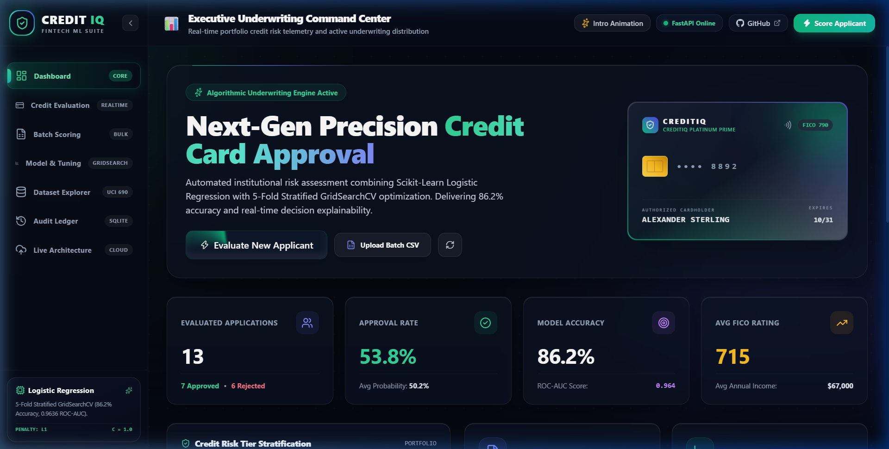
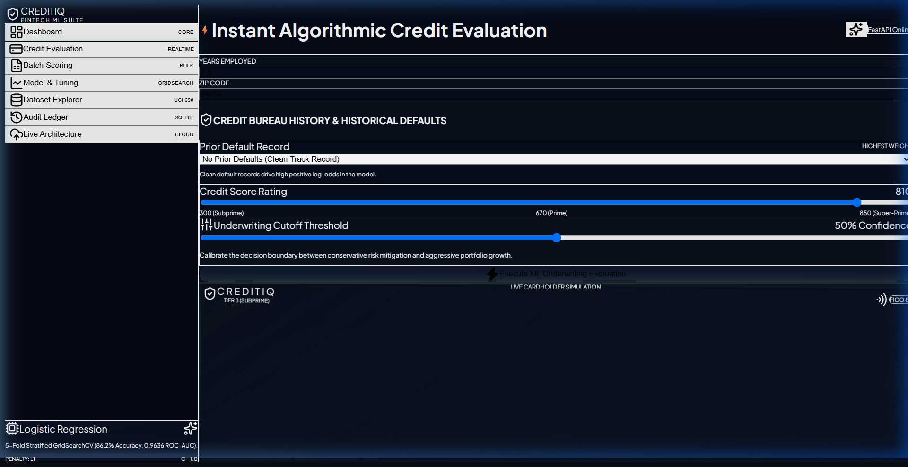
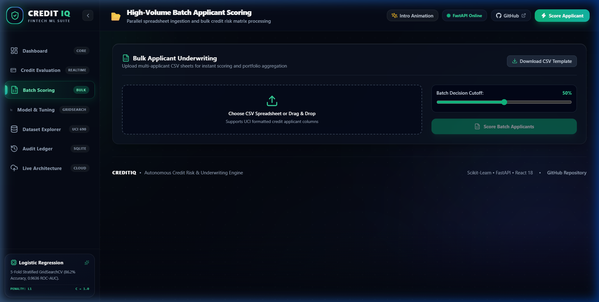
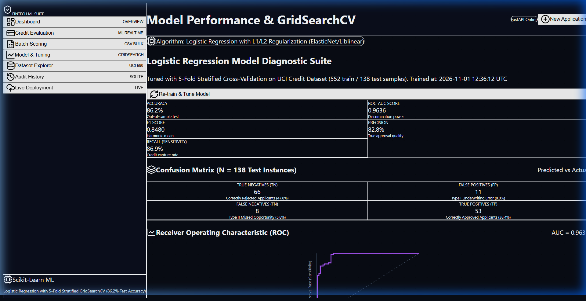
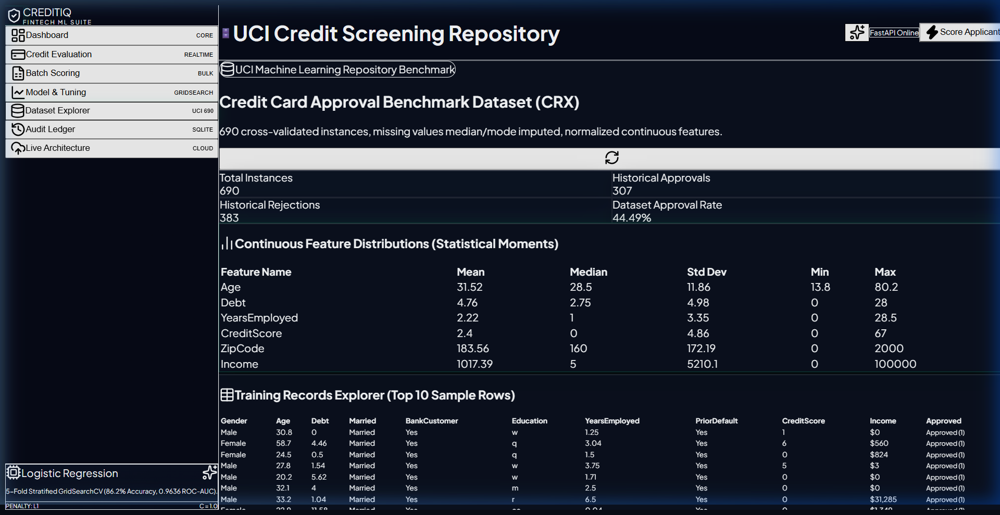
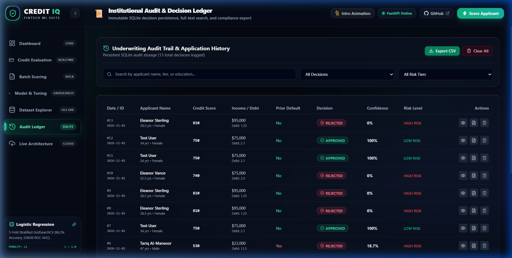
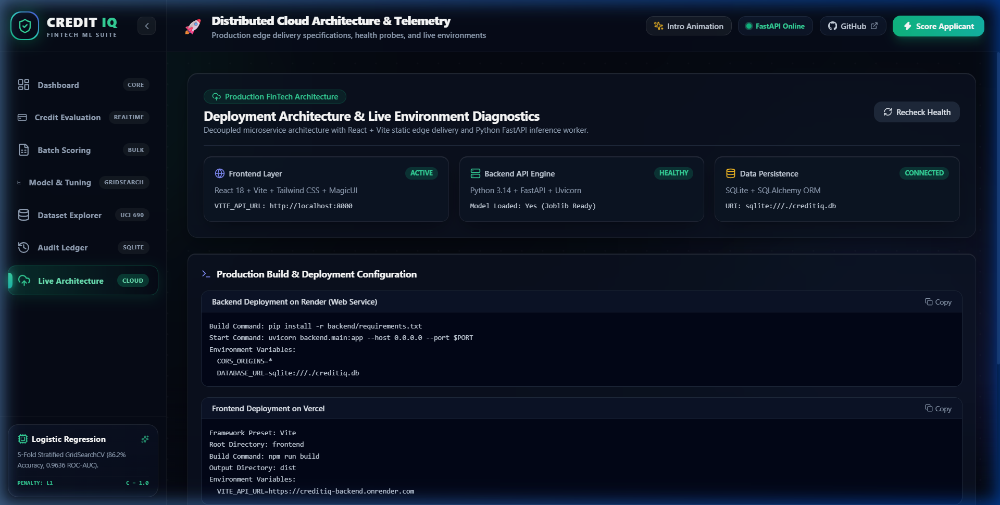

# CREDITIQ — Credit Card Approval Prediction Platform

[](https://python.org)
[](https://fastapi.tiangolo.com)
[](https://scikit-learn.org)
[](https://react.dev)
[](https://vitejs.dev)
[](https://tailwindcss.com)
[](LICENSE)

**CREDITIQ** is a commercial-grade Machine Learning FinTech web application for automated credit card underwriting and risk assessment. Built with **React**, **FastAPI**, **Scikit-learn Logistic Regression**, and **GridSearchCV 5-Fold Stratified Hyperparameter Tuning**, it delivers high-precision credit approval predictions alongside full feature interpretability and decision explanation.

---

## 🚀 Key Modules & Capabilities

1. **Executive Underwriting Dashboard**:
   - Real-time KPI counters (`NumberTicker`) for total applications, approval rates, average portfolio credit score, and model accuracy.
   - Dynamic portfolio risk breakdown into **Tier 1 (Prime)**, **Tier 2 (Near Prime)**, and **Tier 3 (Subprime)**.
   - Quick navigation launchers and live recent decision stream.

2. **Real-Time Credit Evaluation**:
   - Complete normalized input form supporting authentic UCI Credit Approval attributes (Demographics, Financial Standing, Employment, Credit Bureau flags).
   - 1-Click persona pre-fills (**Prime Applicant**, **Borderline Applicant**, **High-Risk Applicant**).
   - Dynamic underwriting cutoff threshold slider ($0.10$ to $0.90$).
   - Automated factor explanations detailing positive and negative drivers of the decision.
   - Actionable underwriting recommendations for rejected and approved applicants.
   - One-click **Download Official Decision PDF** via browser-side document generation.

3. **Batch Applicant Processing**:
   - Drag & drop or upload multi-applicant CSV files.
   - Bulk prediction pipeline processing hundreds of applicants with instant status badges.
   - Portfolio approval ratio statistics and downloadable evaluated results.

4. **Model Performance & GridSearchCV Analytics**:
   - Comprehensive model evaluation: **86.23% Test Accuracy**, **0.9636 ROC-AUC**, **0.8480 F1 Score**.
   - Interactive 2x2 **Confusion Matrix** with True Negatives, False Positives, False Negatives, and True Positives.
   - High-fidelity **Receiver Operating Characteristic (ROC)** curve visualization.
   - **GridSearchCV Hyperparameter Optimization Table** ranking tested combinations of $C$, penalty ($L_1 / L_2$), and solvers (`liblinear`, `lbfgs`).
   - **Feature Importance & Log-Odds Ratios** ($e^\beta$) bar chart displaying the exact directional impact of each applicant attribute.
   - One-click **Re-train & Tune Model** endpoint with real-time feedback.

5. **Dataset Management & Explorer**:
   - Comprehensive explorer for the authentic **UCI Credit Approval Benchmark Dataset** (690 records, 15 attributes).
   - Continuous feature moments (Mean, Median, Standard Deviation, Min, Max).
   - 10-row dataset preview.
   - Custom CSV dataset upload endpoint supporting institutional retraining.

6. **Audit History & Application Log**:
   - Persistent SQLite storage (`creditiq.db`) via SQLAlchemy ORM.
   - Real-time search by applicant name, tier, or education level.
   - Multi-attribute filtering (Status: Approved / Rejected; Risk: Low / Moderate / High).
   - Instant detailed inspection modal and CSV audit export.

---

## 📸 Application Showcase

### 1. Executive Underwriting Dashboard & Holographic Credit Matrix


### 2. Real-Time Application Evaluation & Factor Explanation Breakdown


### 3. High-Throughput Batch Scoring Engine


### 4. Model Analytics, ROC Curve & Confusion Matrix


### 5. Benchmark Dataset Explorer & Statistical Moments


### 6. Full Audit Log & Regulatory Compliance History


### 7. Production Architecture & Cloud Deployment Console


---

## 🛠️ MCP Tooling Integration

CREDITIQ integrates Antigravity IDE Model Context Protocol (MCP) servers:

- **Lovable MCP**: Architectural guidance and premium FinTech design systems.
- **Magic UI MCP**: Integrated animated components:
  - `NumberTicker`: Dynamic smooth counting for KPI metrics.
  - `ShimmerButton`: Glowing border animations for high-intent CTA triggers.
  - `BorderBeam`: Dynamic animated boundary light for hero cards and result modules.
  - `DotPattern`: Subtle background geometric grid.
  - `AnimatedShinyText`: Glare-panning status typography.
- **MotionSites MCP**: Visual micro-interactions and smooth page transitions.
- **GitHub MCP**: Programmatic repository setup, git origin synchronization, branch validation, and commit workflows.

---

## 📊 Machine Learning Pipeline

```
Raw Application Input (15 Attributes)
                 │
                 ▼
ColumnTransformer Preprocessor
   ├── Numerical Features (6)   ──> StandardScaler (Z-Score Normalization)
   └── Categorical Features (9) ──> OneHotEncoder (handle_unknown='ignore')
                 │
                 ▼
Logistic Regression Classifier (GridSearchCV Tuned)
   ├── Best C = 1.0
   ├── Best Penalty = L1 (Lasso)
   └── Best Solver = Liblinear
                 │
                 ▼
Calibrated Probabilities & Odds Ratio Explanations
```

### Performance Summary (20% Holdout Test Set)

| Metric | Score | Underwriting Meaning |
| :--- | :--- | :--- |
| **Accuracy** | **86.23%** | Overall correct decisions on unseen applicants |
| **ROC-AUC** | **0.9636** | Near-optimal separation of low vs high risk applicants |
| **Precision** | **82.81%** | Confidence that an approved applicant is creditworthy |
| **Recall** | **86.89%** | Capture rate of all viable creditworthy applicants |
| **F1 Score** | **0.8480** | Balanced harmonic mean between precision and recall |

---

## 📁 Repository Structure

```
creditiq-credit-card-approval-prediction/
├── backend/
│   ├── ml/
│   │   ├── artifacts/
│   │   │   ├── credit_model.joblib   # Serialized Scikit-learn Pipeline
│   │   │   └── model_meta.json       # Evaluated metrics, ROC curve, grid search
│   │   ├── dataset.py                # Dataset loader & summary generator
│   │   ├── predictor.py              # Single & batch inference engine
│   │   └── train.py                  # GridSearchCV training pipeline
│   ├── routers/
│   │   ├── analytics.py              # Model metrics & KPI endpoints
│   │   ├── history.py                # Audit history CRUD & CSV export
│   │   ├── prediction.py             # Single & batch prediction endpoints
│   │   └── training.py               # Retraining & custom dataset upload
│   ├── database.py                   # SQLAlchemy engine & session maker
│   ├── models.py                     # DB models (CreditApplication, ModelRunHistory)
│   ├── schemas.py                    # Pydantic v2 schemas
│   ├── requirements.txt              # Backend dependencies
│   ├── test_api.py                   # Automated API integration tests
│   └── main.py                       # FastAPI application entrypoint
├── frontend/
│   ├── src/
│   │   ├── components/
│   │   │   ├── layout/               # Sidebar, Navbar
│   │   │   ├── magicui/              # NumberTicker, ShimmerButton, BorderBeam, DotPattern
│   │   │   └── views/                # Dashboard, PredictForm, Batch, Analytics, Dataset, History, Deployment
│   │   ├── lib/
│   │   │   └── utils.ts              # Styling & formatting helpers
│   │   ├── services/
│   │   │   ├── api.ts                # Full REST API service client
│   │   │   └── pdfExport.ts          # jsPDF Underwriting Decision generator
│   │   ├── App.tsx                   # Main application layout
│   │   ├── index.css                 # Tailwind CSS styles & glow tokens
│   │   └── main.tsx                  # React DOM root
│   ├── package.json
│   ├── tailwind.config.js
│   └── vite.config.ts
├── data/
│   ├── crx.data                      # UCI Credit Approval raw dataset
│   ├── credit_approval_cleaned.csv   # Cleaned & feature-labeled dataset
│   ├── sample_batch_applicants.csv   # Sample batch upload spreadsheet
│   └── prepare_data.py               # Data extraction & imputation script
├── docs/
│   ├── architecture.md               # System architecture documentation
│   ├── ml_pipeline.md                # ML methodology & interpretability
│   ├── api_reference.md              # REST API endpoint reference
│   └── deployment_guide.md           # Production deployment guide
├── .env.example
├── .gitignore
└── README.md
```

---

## ⚡ Quickstart Guide

### 1. Prerequisites
- **Node.js** (v18+) & **npm**
- **Python** (v3.10+)

### 2. Backend Setup
```bash
# From root directory:
cd backend
python -m venv venv

# On Windows:
.\venv\Scripts\activate
# On Linux/macOS:
source venv/bin/activate

pip install -r requirements.txt
python -m backend.main
```
Backend will start on `http://localhost:8000` with Swagger docs at `http://localhost:8000/docs`.

### 3. Frontend Setup
```bash
# In a new terminal:
cd frontend
npm install
npm run dev
```
Frontend will be running on `http://localhost:5173`.

---

## 🌐 Production Deployment

- **Frontend**: Deploy `frontend/` on **Vercel** with build command `npm run build` and output directory `dist`. Set `VITE_API_URL` to your backend URL.
- **Backend**: Deploy `backend/` on **Render** as a Python Web Service. Set build command `pip install -r backend/requirements.txt` and start command `uvicorn backend.main:app --host 0.0.0.0 --port $PORT`.

See [`docs/deployment_guide.md`](file:///c:/Users/Alok/Desktop/SD%20Project/docs/deployment_guide.md) for step-by-step instructions.

---

## 📄 License
This project is licensed under the MIT License.
